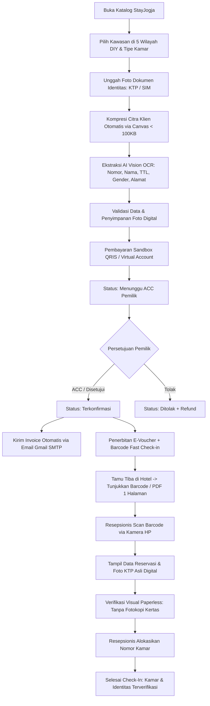
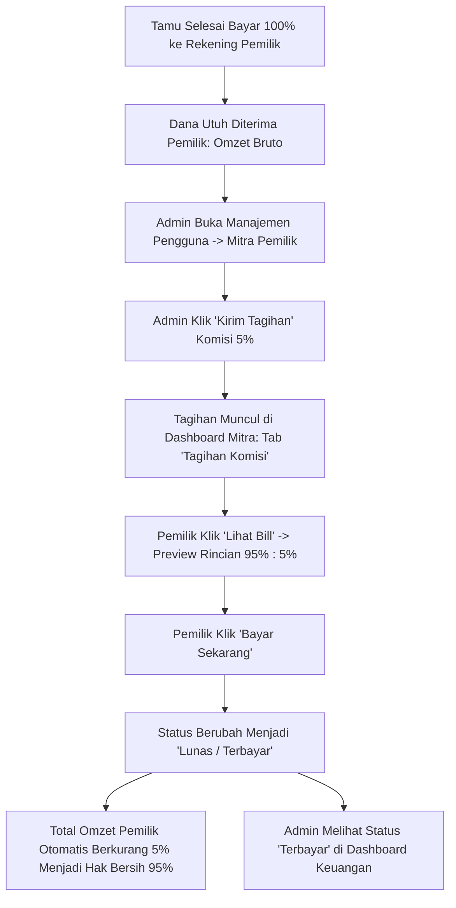

# Product Requirements Document (PRD)
## Aplikasi Reservasi Akomodasi Jogja ("StayJogja")

- **Versi:** 2.1 (Updated Production Baseline)
- **Tanggal:** 14 Oktober 2026
- **Status:** Approved / Production-Ready Prototype
- **Disusun untuk:** Skripsi — Pengembangan Prototipe Aplikasi Reservasi Akomodasi (Hotel, Homestay, Apartemen) dengan Fast Check-in QR Barcode, Sistem Bagi Hasil 95%:5%, Pemindaian & Verifikasi Identitas Sah KTP/SIM dengan AI Vision & OCR, Paperless Check-In Tanpa Fotokopi Fisik, Alokasi Kamar Resepsionis, dan Rekomendasi Cerdas di D.I. Yogyakarta

---

## 1. Latar Belakang

Aplikasi ini adalah platform reservasi akomodasi dengan alur terpadu mirip *Online Travel Agent* (OTA) populer seperti Traveloka atau Agoda, tetapi difokuskan secara eksklusif pada layanan akomodasi di wilayah Daerah Istimewa Yogyakarta (DIY) tanpa tiket transportasi.

Cakupan akomodasi dirancang inklusif untuk wilayah DIY:
1. **Hotel** (rentang bintang 1 hingga 5, serta hotel melati non-bintang)
2. **Homestay** (guest house / rumah sewa harian ramah keluarga)
3. **Apartemen** (unit sewa harian/mingguan)

### Nilai Tambah & Diferensiasi Utama
- **Paperless Fast Check-in Resepsionis & Eliminasi Fotokopi KTP/SIM:** Resepsionis cukup memindai (*scan*) barcode dari e-voucher tamu menggunakan kamera HP. Foto fisik asli KTP/SIM tamu yang telah diunggah saat booking langsung tampil di portal resepsionis secara digital (lengkap dengan fitur Lightbox zoom), sehingga **meniadakan kebutuhan fotokopi kertas KTP/SIM di front desk**, menghemat biaya operasional, dan mempercepat antrean check-in hingga hitungan detik.
- **Pemindaian Dokumen Sah KTP & SIM Otomatis Berbasis AI Vision (OCR):** Tamu dapat mengunggah foto KTP atau SIM (Surat Izin Mengemudi) sebagai alternatif dokumen sah (misal tamu bepergian/lupa membawa KTP). Sistem secara otomatis mengekstrak Nomor Identitas, Nama Lengkap, Tempat & Tanggal Lahir, Jenis Kelamin, dan Alamat menggunakan Google Gemini Vision AI OCR secara instan.
- **Kompresi Gambar Otomatis Sisi Klien (*Client-Side Image Compression*):** Sebelum diunggah, foto identitas dikompresi otomatis via HTML5 Canvas (resolusi maksimum 1000px, kualitas 0.82) menjadi ~70–100 KB. Langkah ini mencegah kegagalan kuota `localStorage` browser (limit 5MB) dan pembatasan muatan Vercel Serverless (limit 4.5MB).
- **Alokasi Nomor Kamar Dinamis di Meja Resepsionis:** Resepsionis dapat langsung menetapkan atau mengganti nomor kamar tamu (melalui tombol preset cepat 101, 102, 201, 202 atau input kustom) saat memproses check-in.
- **Skema Bagi Hasil Transparan (95% Pemilik : 5% Platform):** Tamu membayar 100% langsung ke mitra pemilik; Admin kemudian menagihkan komisi platform sebesar 5% melalui invoice penagihan resmi, dan pemilik melunasinya secara mandiri di dashboard mereka.
- **Notifikasi Email Invoice Resmi Otomatis (Gmail SMTP):** Invoice resmi dikirimkan langsung ke email tamu segera setelah pesanan disetujui (ACC) oleh pemilik.
- **Ekspor Dokumen E-Voucher Presisi 1 Halaman (A4):** Format cetak PDF yang diisolasi ketat agar pas 1 halaman penuh tanpa halaman kosong berlebih.
- **Chatbot Rekomendasi Cerdas Berbasis AI (Gemini):** Memberikan rekomendasi wisata lokal, kuliner khas, dan estimasi budget di sekitar kawasan akomodasi yang dipilih.

---

## 2. Tujuan Produk

1. **Bagi Wisatawan (Tamu):**
   - Mempermudah pencarian dan pemesanan akomodasi di seluruh 5 kabupaten/kota DIY secara akurat.
   - Pendaftaran identitas cepat tanpa input manual berulang melalui auto-scan KTP/SIM berbasis AI Vision.
   - Mempercepat proses registrasi saat tiba di hotel dengan barcode check-in paperless tanpa serah-terima fotokopi fisik.
   - Menerima bukti pembayaran dan e-voucher sah melalui aplikasi dan email.
2. **Bagi Pemilik Akomodasi (Mitra Pemilik):**
   - Mengelola pendaftaran unit, persetujuan reservasi (ACC / Tolak), dan memantau pendapatan bersih.
   - Menerima arsip digital identitas tamu yang rapi tanpa tumpukan kertas fotokopi di resepsionis.
   - Membayar tagihan komisi platform 5% secara transparan melalui sistem invoice digital.
3. **Bagi Administrator:**
   - Mengawasi ekosistem melalui pemisahan data pengguna (Admin, Pemilik, Tamu).
   - Menagih dan memantau status komisi platform serta memoderasi properti dan transaksi global.
4. **Bagi Resepsionis (Frontdesk Staff):**
   - Mengurangi beban kerja administrasi, antrean meja depan, dan pemborosan kertas fotokopi identitas.
   - Mengalokasikan nomor kamar secara fleksibel dan cepat saat tamu tiba.

---

## 3. Ruang Lingkup (Scope)

### 3.1 Termasuk dalam Scope (In-Scope)
- **Pencarian Komprehensif Wilayah DIY:** Cakupan 5 daerah (Kota Yogyakarta, Sleman, Bantul, Kulon Progo, Gunungkidul).
- **OCR Dokumen Identitas KTP & SIM:** Ekstraksi otomatis data identitas (NIK/No. SIM, Nama, TTL, Jenis Kelamin, Alamat) via Gemini Vision AI.
- **Kompresi Citra Klien Otomatis:** Optimasi ukuran gambar KTP/SIM di sisi browser (< 100 KB) demi efisiensi storage & transmisi.
- **Alur Reservasi Lengkap:** Pemesanan kamar → Input/Scan Identitas → Pembayaran (Sandbox QRIS/VA) → ACC oleh Pemilik → Pengiriman Invoice ke Email → Terbit Barcode Check-in.
- **Portal Fast Check-In Resepsionis Paperless:** Scan QR barcode berbasis URL Cloud publik, menampilkan foto KTP asli digital tamu, alokasi nomor kamar, dan penyelesaian check-in instan.
- **Endpoint Frontdesk Photo Attachment:** Fasilitas pembaruan/unggah ulang foto identitas tamu dari front desk (`POST /api/reservations/:code/ktp-photo`).
- **Manajemen Finansial & Skema Komisi 5%:** Billing tagihan komisi dari Admin ke Pemilik dan kalkulasi omzet bersih (95%).
- **Manajemen Profil Pengguna Global:** Pembaruan profil (Nama, Email, Telepon, Alamat) untuk seluruh role.
- **AI Chatbot Wisata & Kuliner:** Integrasi Google Gemini AI dengan guardrail khusus Daerah Istimewa Yogyakarta.
- **Cloud Architecture & Deployment:** Terhubung ke Supabase Cloud (PostgreSQL & Storage) dan di-deploy ke Vercel Serverless.

### 3.2 Di Luar Scope (Out-of-Scope)
- Tiket transportasi (pesawat, kereta api, bus antar-kota).
- Akomodasi di luar provinsi D.I. Yogyakarta.
- Integrasi API Dukcapil instansi pemerintah secara langsung (menggunakan verifikasi format nomor identitas resmi dan validasi AI Vision OCR).
- Transaksi perbankan riil non-sandbox.

---

## 4. Definisi Role & Aktor

| Role | Deskripsi | Hak Akses Utama |
| :--- | :--- | :--- |
| **User (Tamu / Wisatawan)** | Pengguna yang mencari, memesan, membayar akomodasi, dan melakukan check-in via barcode. | Pencarian katalog, filter kawasan DIY, booking unit, unggah foto KTP/SIM dengan auto-kompresi & OCR AI, pembayaran sandbox, cetak PDF voucher 1 lembar, terima email invoice, edit profil, interaksi chatbot AI. |
| **Mitra Pemilik (Owner)** | Pemilik atau pengelola operasional hotel, homestay, atau apartemen. | Registrasi properti & tipe unit, persetujuan (ACC)/penolakan reservasi masuk, melihat tagihan komisi 5%, bayar komisi platform, monitoring omzet bersih, akses arsip digital identitas tamu, edit profil. |
| **Admin** | Pengelola sistem dan verifikator platform StayJogja. | Moderasi akun terpisah (Admin, Pemilik, Tamu), kirim tagihan komisi ke pemilik, monitoring status settlement komisi, audit reservasi global, moderasi properti, edit profil. |
| **Resepsionis (Frontdesk Staff)** | Petugas hotel yang memverifikasi kedatangan tamu di meja depan. | Pindai barcode QR tamu dari kamera smartphone, memverifikasi foto asli KTP/SIM digital secara paperless (tanpa fotokopi fisik), menetapkan/mengubah nomor kamar tamu, unggah ulang foto identitas bila diperlukan, dan menyelesaikan status check-in. |

---

## 5. User Flow Utama

### 5.1 Flow Pemesanan Tamu & Fast Check-In Paperless


### 5.2 Flow Skema Bagi Hasil & Pembayaran Komisi 5%


---

## 6. Functional Requirements (FR)

### 6.1 Modul Pencarian & Filter Kawasan Lengkap DIY
- **FR-1:** Pemilihan destinasi/kawasan dikelompokkan secara terstruktur mencakup seluruh wilayah DIY:
  - **Kota Yogyakarta:** Malioboro, Prawirotaman, Kotabaru, Kotagede, Keraton, Alun-Alun Kidul, dll.
  - **Kabupaten Sleman:** Depok, Seturan, Babarsari, Kaliurang, Gejayan, Prambanan, dll.
  - **Kabupaten Bantul:** Parangtritis, Dlingo, Mangunan, Kasongan, Imogiri, dll.
  - **Kabupaten Kulon Progo:** YIA, Glagah, Wates, Kalibawang, dll.
  - **Kabupaten Gunungkidul:** Wonosari, Baron, Indrayanti, Drini, Timang, dll.
- **FR-2:** Filter berdasarkan tipe akomodasi (Semua, Hotel, Homestay, Apartemen), rentang harga, klasifikasi bintang, dan fasilitas.

### 6.2 Modul Identitas & AI Vision OCR (KTP & SIM)
- **FR-3 (Dukungan Identitas Sah KTP & SIM dengan AI OCR):** Sistem mendukung verifikasi dokumen identitas resmi negara berupa e-KTP dan SIM (Surat Izin Mengemudi) sebagai alternatif saat tamu bepergian. Ekstraksi otomatis berbasis Google Gemini AI Vision memproses citra untuk mengidentifikasi Nomor Identitas (NIK/No. SIM), Nama Lengkap, Tempat & Tanggal Lahir, Jenis Kelamin, dan Alamat secara presisi.
- **FR-4 (Kompresi Citra Klien Otomatis & Proteksi Penyimpanan):** Sistem secara otomatis mereduksi dimensi (maks 1000px) dan memadatkan kualitas citra (0.82 JPEG) di sisi browser melalui HTML5 Canvas sebelum transmisi. Berkas foto terkompresi (~70–100 KB) disimpan sebagai arsip digital identitas tanpa membebani kuota `localStorage` browser (limit 5MB) dan batasan muatan payload Vercel (limit 4.5MB).

### 6.3 Modul E-Voucher, Barcode QR & Cetak PDF 1 Halaman
- **FR-5:** Pembuatan QR Code dinamis berbasis URL Cloud publik (`https://.../checkin/:code`) yang dapat di-scan dari kamera HP mana pun (koneksi 4G/5G/Wi-Fi).
- **FR-6:** Modal cetak PDF yang diisolasi dengan `@media print` (`display: none !important` pada elemen latar) sehingga menghasilkan **tepat 1 halaman A4** bersih tanpa halaman kosong berlebih.

### 6.4 Modul Pengiriman Email Otomatis
- **FR-7:** Pengiriman email konfirmasi dan invoice otomatis ke alamat email tamu menggunakan integrasi Gmail SMTP (`nodemailer`) segera setelah pesanan di-ACC oleh mitra pemilik.

### 6.5 Modul Finansial & Tagihan Komisi 5%
- **FR-8:** Perhitungan otomatis nilai transaksi: Gross (100%), Komisi Platform (5%), dan Hak Bersih Pemilik (95%).
- **FR-9:** Fitur penagihan komisi dari Admin ke Pemilik pada Manajemen Pengguna.
- **FR-10:** Modal pratinjau tagihan (*Lihat Bill*) di dashboard pemilik dengan rincian biaya resmi sebelum pembayaran.
- **FR-11:** Penyesuaian nilai KPI Total Omzet pemilik yang otomatis berkurang menjadi hak bersih 95% setelah status komisi lunas.

### 6.6 Modul Manajemen Pengguna & Edit Profil Global
- **FR-12:** Pemisahan tabel akun di dashboard Admin menjadi 3 tabel terpisah: **Administrator**, **Mitra Pemilik**, dan **Tamu / Wisatawan**.
- **FR-13:** Fitur Edit Profil global untuk Tamu, Pemilik, dan Admin untuk memperbarui nama, email, nomor HP, dan alamat secara real-time.

### 6.7 Modul Chatbot Cerdas AI (Gemini)
- **FR-14:** Rekomendasi wisata dan kuliner lokal berbasis Google Gemini API dengan batasan topik seputar Yogyakarta.

### 6.8 Modul Meja Depan Resepsionis & Paperless Check-In
- **FR-15 (Paperless Check-In & Tampilan Foto Identitas Digital):** Portal resepsionis memunculkan foto fisik asli KTP/SIM yang telah diunggah tamu pada saat booking sesaat setelah barcode dipindai. Dilengkapi fitur pratinjau Lightbox resolusi penuh, petugas front desk dapat langsung mencocokkan wajah tamu tanpa memerlukan fotokopi kertas fisik KTP/SIM.
- **FR-16 (Alokasi Nomor Kamar Dinamis & Pembaruan Foto Front Desk):** Resepsionis dapat langsung menetapkan nomor kamar (tombol preset 101, 102, 201, 202 atau kustom) pada modal check-in, serta mengunggah ulang foto identitas tamu melalui endpoint `POST /api/reservations/:code/ktp-photo` apabila dokumen tamu baru diperlihatkan di meja depan.

---

## 7. Non-Functional Requirements (NFR)

| ID | Kategori | Spesifikasi Target |
| :--- | :--- | :--- |
| **NFR-1** | **Keamanan** | Enkripsi kata sandi menggunakan `bcrypt`. Pemisahan variabel sensitif via `.env` dan `.env.example`. |
| **NFR-2** | **Kompabilitas Deployment** | Arsitektur backend stateless Express.js yang siap di-deploy ke Vercel Serverless Functions via `vercel.json`. |
| **NFR-3** | **Aksesibilitas Barcode** | QR Code dapat dibaca oleh kamera smartphone standar dalam < 1 detik melalui koneksi internet seluler (4G/5G). |
| **NFR-4** | **Ketepatan Cetak** | Hasil cetak / save as PDF invoice reservasi wajib terkunci pada 1 halaman standar A4. |
| **NFR-5** | **Database Cloud** | Menggunakan Supabase PostgreSQL Cloud dengan skema relasional terpusat. |
| **NFR-6** | **Efisiensi Payload & Citra** | Seluruh citra identitas dikompresi di sisi klien menjadi < 120 KB (resolusi maks 1000px) sebelum dikirim, menjamin kepatuhan batas payload Vercel (< 4.5MB) dan penyimpanan `localStorage`. |
| **NFR-7** | **Kinerja Ekstraksi OCR AI** | Waktu respons pemrosesan citra dokumen KTP/SIM menggunakan Gemini Vision AI rata-rata < 3,5 detik pada koneksi internet standar. |

---

## 8. Arsitektur Sistem & Cloud Stack

```
+-------------------------------------------------------------+
|             Frontend Client (HTML5 + Tailwind CSS + JS)     |
|   - Katalog & Filter Kawasan DIY   - E-Voucher A4 1-Page     |
|   - Client Image Compressor (Canvas)- KTP & SIM OCR Scanner   |
|   - Dashboard Tamu / Pemilik       - Dashboard Admin         |
|   - Portal Check-In Paperless Resepsionis (No Photocopy)    |
|   - Room Assignment Controller     - Widget AI Chatbot       |
+-------------------------------------------------------------+
                              │
                        HTTPS / JSON
                              ▼
+-------------------------------------------------------------+
|         Backend: Node.js + Express (Vercel Serverless)       |
|  ├── Auth & Profile Service       ├── OCR Vision AI Service |
|  ├── Property & Booking Service   ├── QR Code Generator     |
|  ├── Finance & 5% Billing Service ├── Nodemailer SMTP       |
|  ├── KTP Photo Frontdesk Handler  └── Gemini Chatbot Service|
+-------------------------------------------------------------+
        │                           │                    │
        ▼                           ▼                    ▼
+-------------------+      +-----------------+  +-----------------+
|   Supabase Cloud  |      |   Gmail SMTP    |  |  Google Gemini  |
|  (PostgreSQL DB)  |      | (Email Invoice) |  |   (AI Vision &  |
|   & Cloud Storage |      | (Email Invoice) |  |    Chatbot)     |
+-------------------+      +-----------------+  +-----------------+
```

---

## 9. Status Implementasi Fitur

| Fitur / Modul | Status | Keterangan |
| :--- | :---: | :--- |
| Katalog & Filter Seluruh Kawasan DIY | **Selesai (100%)** | 5 Kabupaten/Kota terakomodasi lengkap |
| Alur Booking & Pembayaran Sandbox | **Selesai (100%)** | QRIS & Virtual Account |
| Ekstraksi Dokumen Sah KTP & SIM via AI Vision OCR | **Selesai (100%)** | Parsing cerdas nomor identitas, nama, TTL, gender, alamat |
| Kompresi Citra Klien Otomatis (Anti-Quota Exceeded) | **Selesai (100%)** | Kompresi HTML5 Canvas ke ~70–100 KB, aman di localStorage & Vercel |
| Paperless Front Desk Check-In (Zero Kertas Fotokopi) | **Selesai (100%)** | Foto asli KTP/SIM tampil di portal resepsionis + Lightbox zoom |
| Alokasi & Penetapan Nomor Kamar Resepsionis | **Selesai (100%)** | Preset 101, 102, 201, 202 & input kustom saat check-in |
| Endpoint Unggah Foto KTP Front Desk (`POST /:code/ktp-photo`)| **Selesai (100%)** | Dukungan pembaruan foto identitas langsung dari front desk |
| Barcode Fast Check-In Resepsionis | **Selesai (100%)** | URL Cloud Publik, scan via kamera HP |
| Pemisahan Tabel Pengguna Admin | **Selesai (100%)** | 3 Tabel terpisah: Admin, Owner, Tamu |
| Tagihan Komisi 5% & Omzet 95% | **Selesai (100%)** | Alur kirim bill, modal bill, & pelunasan |
| Cetak PDF Presisi 1 Halaman A4 | **Selesai (100%)** | Strict print isolation |
| Kirim Invoice via Gmail Otomatis | **Selesai (100%)** | Nodemailer SMTP terintegrasi |
| Edit Profil Global untuk Semua Role | **Selesai (100%)** | Modal & endpoint API sinkron |
| Desain Logo Baru Transparan (Tugu) | **Selesai (100%)** | File PNG transparan aktif di seluruh UI |
| Konfigurasi Deploy Vercel | **Selesai (100%)** | `vercel.json` & serverless handler aktif |

---

## 10. Dokumen Pengesahan

Dokumen PRD ini telah disesuaikan dan diperbarui mencerminkan seluruh implementasi nyata pada sistem aplikasi **StayJogja** per **14 Oktober 2026** sebagai acuan resmi pengujian dan penulisan laporan Skripsi.
